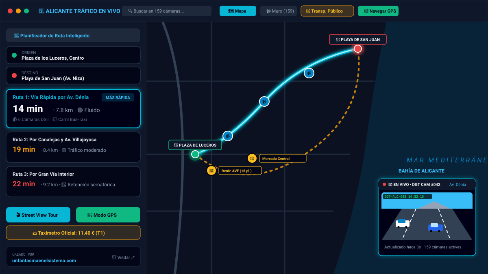
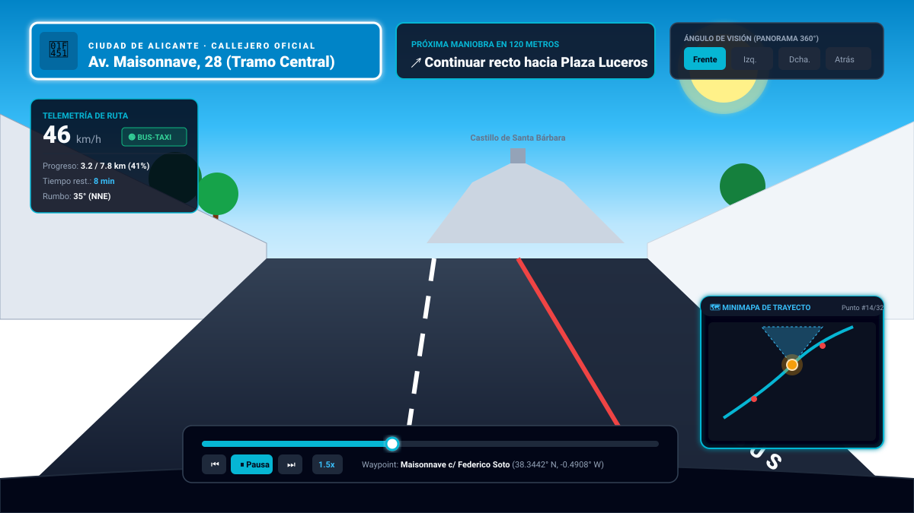
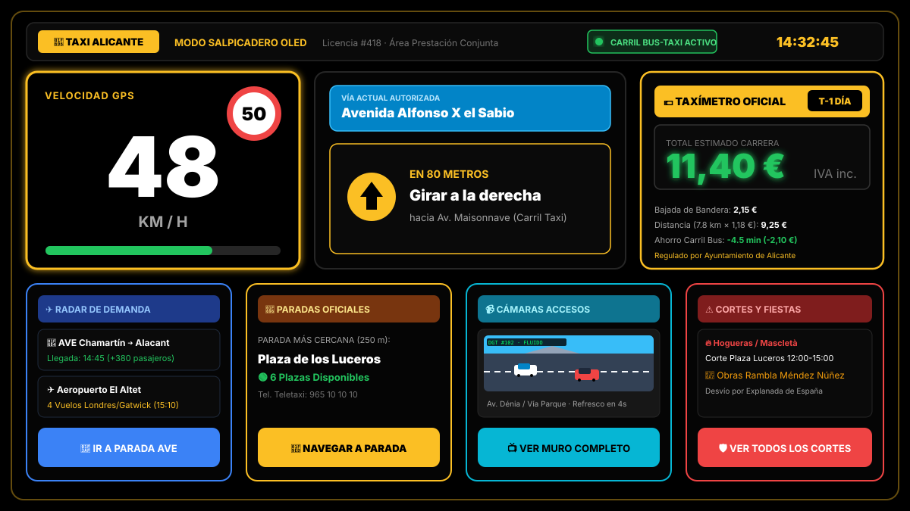
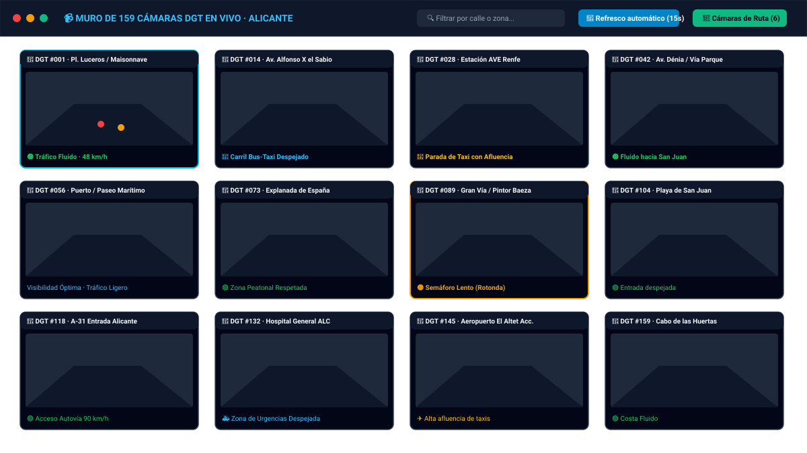

# 🚦 Alicante Tráfico en Vivo · Rutas, Cámaras DGT y Suite Taxi

[](https://react.dev/)
[](https://www.typescriptlang.org/)
[](https://vitejs.dev/)
[](https://tailwindcss.com/)
[](https://leafletjs.com/)
[](https://threejs.org/)
[](https://web.dev/progressive-web-apps/)
[](LICENSE)

> **Plataforma web y móvil integral para monitorizar el tráfico de la ciudad de Alicante en tiempo real.** Calcula las rutas más rápidas evitando retenciones, visualiza las **159 cámaras oficiales de la DGT** en un solo muro interactivo, simula recorridos a pie de calle mediante **Street View panorámico**, y ofrece una **suite profesional específica para taxistas y transporte público** de Alicante.

Creado por [unfantasmaenelsistema.com](https://www.unfantasmaenelsistema.com/).

---

## 📸 Capturas de Pantalla

### 1. Mapa Interactivo y Planificador Inteligente de Rutas
Visualización del trazado con estimación de tiempo, tráfico en tiempo real, cámaras de tráfico en ruta y atajos rápidos.



---

### 2. Tour Virtual Street View Panorámico Sincronizado
Simulación de trayecto real punto a punto a pie de calle, con cartel oficial de calles de Alicante, telemetría de ruta, minimapa con cono de visión y cámara DGT en Picture-in-Picture.



---

### 3. Modo Salpicadero / Taxi Dashboard (OLED Alto Contraste)
Interfaz pensada para soporte de parabrisas en smartphones, con velocímetro gigante, estimador oficial de taxímetro (Tarifa 1 y 2), radar de demanda en AVE y Aeropuerto, y avisos de fiestas/cortes.



---

### 4. Muro de 159 Cámaras de Tráfico DGT en Vivo
Monitorización simultánea de todas las cámaras de Alicante en una sola pantalla, con autorrefresco cada 15 segundos y filtrado instantáneo por calle.



---

## 🌟 Características Principales

### 🗺️ 1. Planificador Inteligente de Rutas en Alicante
- **Cálculo ponderado por tráfico**: Algoritmo de enrutamiento que analiza en tiempo real la fluidez de las vías principales (Avenida de Dénia, Gran Vía, Vía Parque, Maisonnave, Alfonso el Sabio, Canalejas, Autovía A-31).
- **Rutas alternativas simultáneas**: Compara de un vistazo la vía más rápida frente a opciones costeras o interiores, indicando distancia, tiempo estimado y nivel de retención.
- **Simulador de Hora Punta**: Botón rápido para evaluar cómo se comportará el tráfico en los accesos clave durante horas punta de entrada y salida laboral.
- **Detección automática de cámaras en ruta**: Muestra exactamente qué cámaras de la DGT cubren tu recorrido.

### 📹 2. Red de 159 Cámaras DGT en Tiempo Real
- **Muro multicámara único**: Todas las cámaras de Alicante en una cuadrícula optimizada sin sobrecargar la memoria del navegador.
- **Ciclo de refresco continuo**: Actualización automática de instantáneas cada 15 segundos con indicador de cuenta atrás.
- **Modo Picture-in-Picture (PiP)**: Fija cualquier cámara en una ventana flotante para seguir vigilando un cruce mientras navegas por otras pestañas o calculas rutas.
- **Lightbox en alta resolución**: Amplía cualquier imagen a pantalla completa con controles de anterior/siguiente.

### 🧭 3. Tour Virtual 3D y Street View Panorámico
- **Street View a pie de calle**: Recorre visualmente la ruta calculada con imágenes panorámicas sincronizadas con los waypoints de la calzada.
- **Cartelería municipal realista**: Muestra el nombre oficial de la calle y el tramo exacto por el que se circula.
- **Controles de perspectiva**: Cambia el ángulo de visión entre frente (0°), izquierda (-45°), derecha (+45°) y visión trasera (180°).
- **Minimapa dinámico**: Indica la posición del vehículo y la dirección del cono de visión en cada instante.
- **Vuelo 3D Flythrough**: Motor Three.js para sobrevolar la orografía urbana de Alicante y la bahía.

### 🛰️ 4. Navegador GPS Turn-by-Turn
- **Modo Real**: Conexión con la API de geolocalización del dispositivo para navegación asistida en vivo.
- **Modo Simulador**: Permite revisar el paso a paso antes de salir, con velocidad configurable (1x, 2x, 4x) y síntesis de voz (Text-to-Speech) para avisos sonoros de giro.

---

## 🚖 Suite para Transporte Público y Taxistas de Alicante

Activando el modo **"Transporte público"** en la barra superior, la interfaz despliega herramientas exclusivas adaptadas a la normativa municipal de Alicante:

1. **🚖 Red Oficial de Paradas de Taxi y Navegación Rápida**
   - Capa en el mapa con las paradas oficiales de Alicante (Estación AVE Renfe, Estación de Autobuses, Aeropuerto El Altet, Luceros, Mercado Central, Hospital General, Gabriel Miró, Playa de San Juan, Explanada, etc.).
   - Visualización del número de plazas oficiales y navegación directa con un clic.

2. **💶 Estimador de Taxímetro Oficial (Tarifa 1 y Tarifa 2)**
   - Desglose automatizado según la ordenanza del Ayuntamiento de Alicante y la Generalitat Valenciana:
     - **Tarifa 1 (Diurna laborable)** vs. **Tarifa 2 (Nocturna y festivos)**.
     - Bajada de bandera y precio por kilómetro recorrido.
     - Suplementos oficiales aplicables: Aeropuerto Alicante-Elche Miguel Hernández, Estación de Tren AVE Alacant Terminal, nocturnidad (22:00 a 06:00) y domingos/festivos.
     - Ahorro económico y temporal obtenido por circular por carriles reservados.

3. **🚌 Algoritmo de Enrutamiento con «Carril Bus / Taxi»**
   - Acceso autorizado a los carriles reservados de Alicante (Av. Maisonnave, Alfonso X el Sabio, Rambla Méndez Núñez, Av. Aguilera).
   - El motor de enrutamiento reduce drásticamente la penalización por retención en tramos con carril BUS-TAXI, reflejando el tiempo real de llegada para vehículos autorizados.

4. **✈️ Monitor de Demanda en Puntos Críticos (AVE y Aeropuerto)**
   - Panel de control de afluencia de pasajeros:
     - Próximas llegadas de trenes de alta velocidad a **Alacant Terminal**.
     - Picos de afluencia de vuelos en el **Aeropuerto Alicante-Elche (ALC)**.
     - Atraque de cruceros turísticos en el Puerto de Alicante y eventos en el Auditorio ADDA o Recinto Ferial IFA.

5. **📱 Modo Salpicadero / Taxi Dashboard (OLED High Contrast)**
   - Vista especial diseñada para soportes de móvil en el parabrisas:
     - Fondo negro puro `#000000` para reducir fatiga visual y ahorrar batería en pantallas OLED.
     - Velocímetro y reloj de tamaño gigante con límites de velocidad de la vía.
     - Botones táctiles de gran tamaño para interactuar de forma segura.

6. **⚠️ Avisos de Calles Cortadas y Fiestas Locales**
   - Información actualizada sobre afecciones al tráfico por celebraciones tradicionales de Alicante:
     - Mascletàs y monumentos en **Hogueras de San Juan** (corte de Luceros y Alfonso el Sabio).
     - Procesiones de **Semana Santa**, eventos deportivos en el frente marítimo y obras de reasfaltado.

---

## 📱 Soporte PWA (Progressive Web App)
- **Instalable directamente**: Puede agregarse a la pantalla de inicio en iPhone, iPad, Android, macOS y Windows como una aplicación nativa.
- **Funcionamiento Offline**: Service Worker con caché de activos estáticos, interfaz y estilos para arrancar sin conexión.
- **Iconos adaptativos**: Soporte completo para iconos maskable y pantallas retina.

---

## 🛠️ Tecnologías Utilizadas

- **Frontend Core**: [React 19](https://react.dev/), [TypeScript](https://www.typescriptlang.org/)
- **Empaquetador y Dev Server**: [Vite 8](https://vitejs.dev/)
- **Estilos y Diseño**: [Tailwind CSS v4](https://tailwindcss.com/)
- **Mapas y Geometría**: [Leaflet](https://leafletjs.com/), OpenStreetMap cartography
- **Gráficos 3D y WebGL**: [Three.js](https://threejs.org/)
- **Iconografía**: [Lucide React](https://lucide.dev/)
- **Backend / Proxy API**: [Express](https://expressjs.com/) sobre Node.js con `tsx`
- **Inteligencia Artificial (Opcional)**: [@google/genai](https://github.com/google-gemini/generative-ai-js) para análisis semántico del tráfico con modelos Gemini de Google AI Studio.

---

## 🚀 Instalación y Puesta en Marcha

### Prerrequisitos
- **Node.js** v18 o superior instalado en el equipo.
- Gestor de paquetes `npm` (incluido con Node.js), `yarn` o `pnpm`.

### Paso 1: Clonar el repositorio
```bash
git clone https://github.com/unfantasmaenelsistema/alicante-trafico-en-vivo.git
cd alicante-trafico-en-vivo
```

### Paso 2: Instalar dependencias
```bash
npm install
```

### Paso 3: Configurar variables de entorno
Copia la plantilla de variables de entorno:
```bash
cp .env.example .env
```

*(Opcional)* Si deseas utilizar las funciones asistidas por IA de Gemini, añade tu clave API en el archivo `.env`:
```env
GEMINI_API_KEY="tu_clave_api_aqui"
```
> **Nota:** La aplicación funciona al 100% sin necesidad de configurar ninguna API key. Los usuarios también pueden introducir su clave de Gemini de forma privada en el modal de ajustes del navegador.

### Paso 4: Iniciar el servidor de desarrollo
```bash
npm run dev
```
La aplicación se iniciará en `http://localhost:3000`.

### Paso 5: Compilación para producción
```bash
npm run build
npm start
```

---

## 📁 Estructura del Proyecto

```text
├── docs/
│   └── screenshots/          # Capturas de pantalla vectoriales (SVG) para documentación
│       ├── overview.svg      # Vista principal del mapa y planificador
│       ├── streetview.svg    # Vista Street View panorámico sincronizado
│       ├── taxidashboard.svg # Modo Salpicadero OLED para taxistas
│       └── camerawall.svg    # Muro interactivo de 159 cámaras DGT
├── public/                   # Activos estáticos, iconos PWA y manifiesto
│   ├── manifest.json         # Configuración PWA
│   ├── sw.js                 # Service Worker para modo offline
│   └── icono.png             # Icono de la aplicación
├── src/
│   ├── components/           # Componentes modulares de interfaz de usuario
│   │   ├── InteractiveMap.tsx          # Mapa Leaflet con capas y marcadores
│   │   ├── RouteSelector.tsx           # Selección de puntos de origen y destino
│   │   ├── RouteComparisonPanel.tsx    # Comparativa de rutas y taxímetro
│   │   ├── RouteTourModal.tsx          # Modal contenedor del tour virtual
│   │   ├── StreetViewTourView.tsx      # Visor Street View con HUD y minimapa
│   │   ├── GpsNavigatorModal.tsx       # Navegador GPS turn-by-turn con voz
│   │   ├── CameraWall.tsx              # Cuadrícula de 159 cámaras en vivo
│   │   ├── CameraLightbox.tsx          # Visor en pantalla completa de cámaras
│   │   ├── FloatingCameraPip.tsx       # Ventana Picture-in-Picture persistente
│   │   ├── PublicTransportBar.tsx      # Barra de herramientas de transporte público
│   │   ├── TaxiFareModal.tsx           # Calculadora oficial de tarifas 1 y 2
│   │   ├── DemandRadarModal.tsx        # Radar de llegadas AVE y vuelos
│   │   ├── TaxiDashboardModal.tsx      # Salpicadero de alto contraste para coche
│   │   ├── LocalClosuresModal.tsx      # Avisos de fiestas y cortes de tráfico
│   │   └── Header.tsx                  # Cabecera principal con selector de modos
│   ├── data/
│   │   ├── cameras.ts         # Base de datos georreferenciada de cámaras DGT
│   │   └── publicTransport.ts # Paradas de taxi, tarifas, carriles y cortes
│   ├── services/
│   │   ├── routing.ts         # Motor de cálculo de rutas y ponderación
│   │   └── navigation.ts      # Generador de maniobras GPS y telemetría
│   ├── App.tsx                # Componente raíz y orquestador de estado
│   └── main.tsx               # Entrada de la aplicación React
├── server.ts                  # Servidor Express proxy para alertas y caché
├── package.json               # Dependencias y scripts del proyecto
├── tsconfig.json              # Configuración de TypeScript
└── vite.config.ts             # Configuración de Vite con Tailwind CSS
```

---

## 🌐 Opciones de Despliegue en la Nube

El proyecto está preparado para exportarse y desplegarse en cualquier plataforma moderna:

| Plataforma | Tipo | Comando de Build | Comando de Inicio |
| :--- | :--- | :--- | :--- |
| **Vercel** | SPA / Node Server | `npm run build` | `node server.ts` |
| **Render** | Web Service | `npm install && npm run build` | `npm start` |
| **Railway** | Web Service | `npm run build` | `npm start` |
| **Google Cloud Run** | Contenedor Docker | Automático | `node server.ts` |

---

## 🏛️ Fuentes de Información y Créditos

- **Cámaras de Tráfico**: Datos abiertos de la Dirección General de Tráfico (DGT) y Centro de Control de Tráfico del Ayuntamiento de Alicante.
- **Tarifas Oficiales de Taxi**: Reguladas por el Ayuntamiento de Alicante y la Conselleria de Medio Ambiente, Agua, Infraestructuras y Territorio (Generalitat Valenciana).
- **Cartografía**: © [OpenStreetMap](https://www.openstreetmap.org/copyright) contributors.

Desarrollado con dedicación para la ciudad de Alicante por **[Un Fantasma en el Sistema](https://www.unfantasmaenelsistema.com/)**.

---

## 📄 Licencia

Este proyecto se distribuye bajo la licencia **MIT**. Consulta el archivo `LICENSE` para más información.
