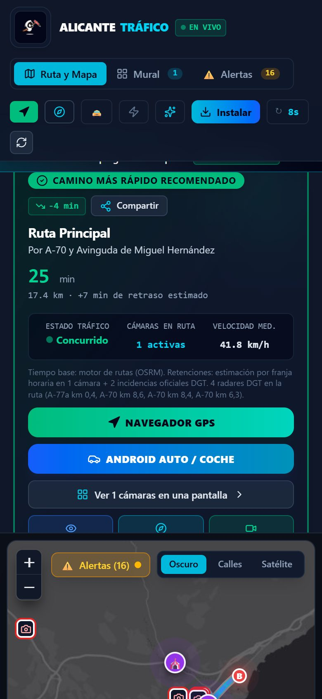
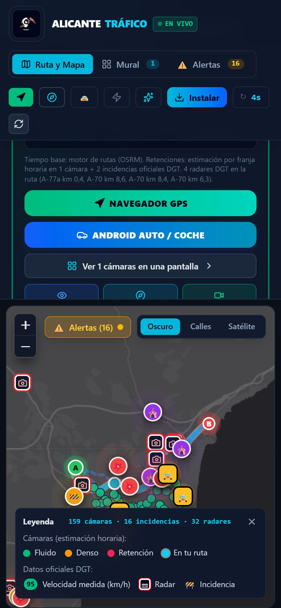
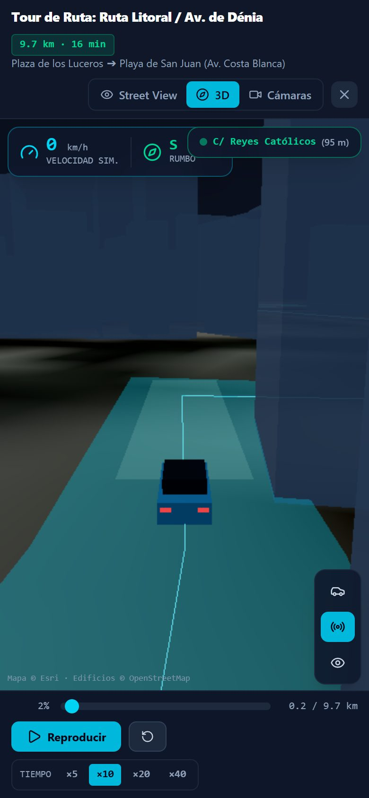
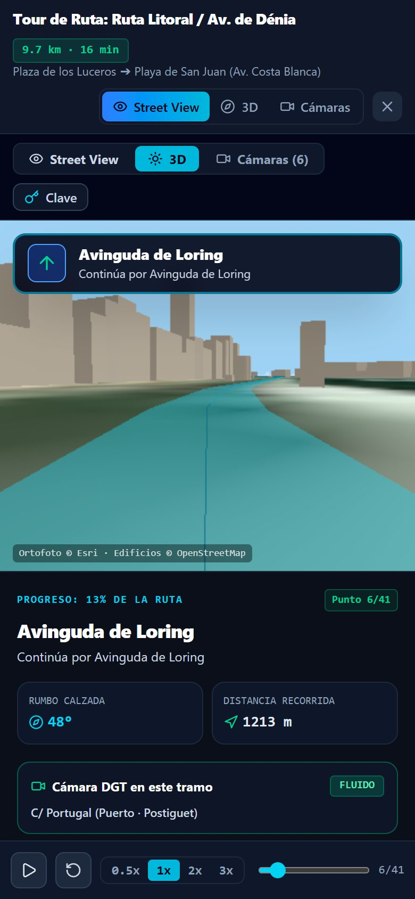
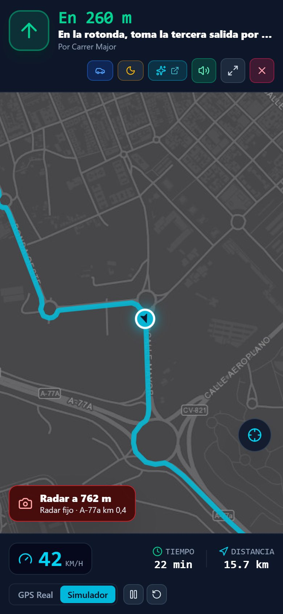
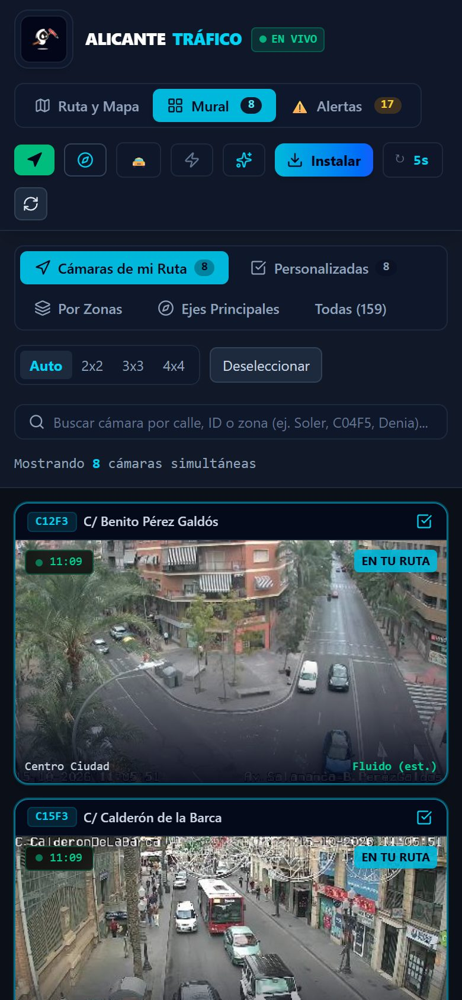
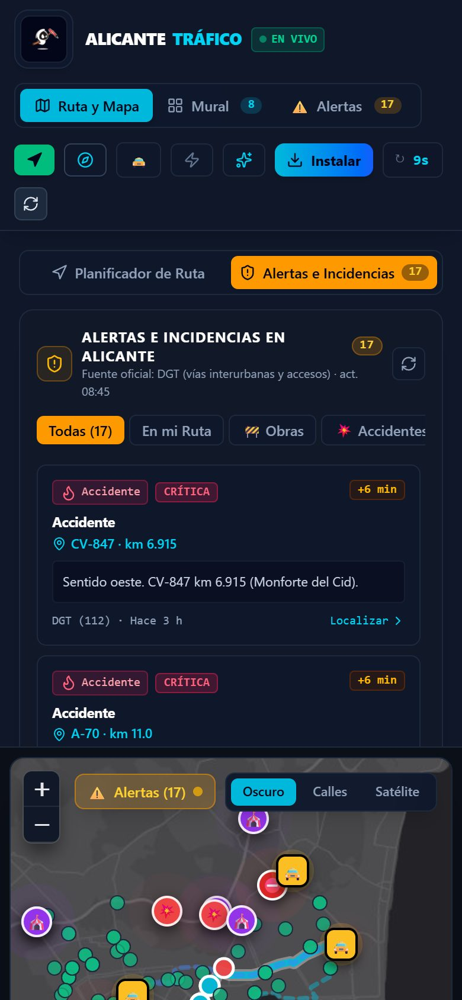
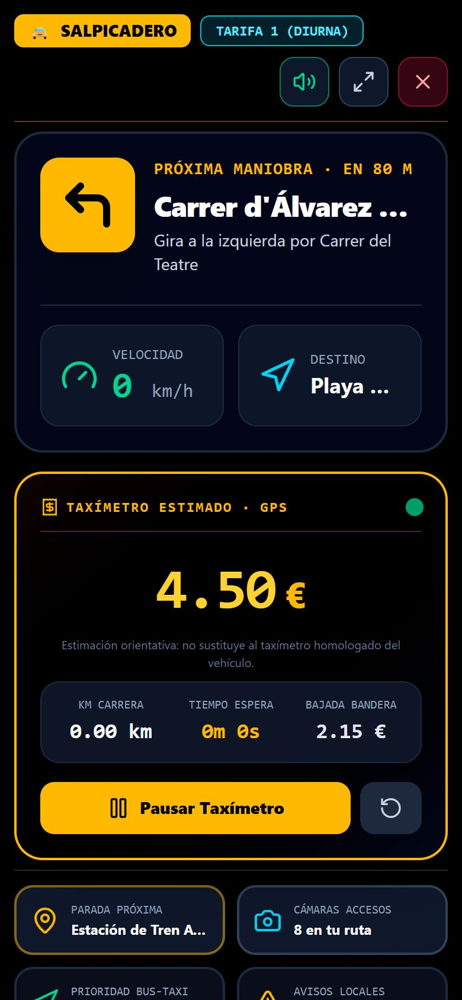

# 🚦 Alicante Tráfico en Vivo · Rutas, Cámaras DGT y Suite Taxi

[](https://react.dev/)
[](https://www.typescriptlang.org/)
[](https://vitejs.dev/)
[](https://tailwindcss.com/)
[](https://leafletjs.com/)
[](https://threejs.org/)
[](https://web.dev/progressive-web-apps/)
[](LICENSE)

> **Plataforma web y móvil para moverse por Alicante.** Calcula rutas reales por el callejero (OSRM), las compara con las **incidencias oficiales de la DGT** en tiempo real y con una estimación de retenciones por franja horaria, muestra las **159 cámaras municipales de tráfico** en un solo muro, recorre la ruta en **3D sobre ortofoto real con edificios de OpenStreetMap**, guía con **GPS paso a paso** y ofrece una **suite para taxistas y transporte público** de Alicante.

**👉 Abrir la app: [jpm70.github.io/alicante-traffic-live](https://jpm70.github.io/alicante-traffic-live/)** — pensada para el móvil (se puede instalar como app) y para el navegador del coche.

Creado por [unfantasmaenelsistema.com](https://www.unfantasmaenelsistema.com/).

---

## 📸 Capturas de Pantalla

Capturas reales de la aplicación en un móvil (390 × 844), ruta Plaza de los Luceros → Playa de San Juan.

| Ruta recomendada | Mapa con la ruta, cámaras e incidencias |
| :---: | :---: |
|  |  |
| **Vuelo 3D** (ortofoto + edificios OSM) | **Conducción 3D** (vista conductor) |
|  |  |
| **Navegador GPS** con cámara próxima | **Mural de cámaras** de la ruta |
|  |  |
| **Incidencias oficiales DGT** | **Salpicadero de taxi** |
|  |  |

---

## 🌟 Características Principales

### 🗺️ 1. Planificador de Rutas en Alicante
- **Rutas reales por calles**: trazado, distancia, tiempo base e indicaciones giro a giro con nombres de calle del motor [OSRM](https://project-osrm.org/) (servidor público y espejo FOSSGIS como respaldo). Si ningún servidor responde, la app lo dice y dibuja una línea punteada marcada como *trazado aproximado*, nunca una recta disfrazada de ruta.
- **Rutas alternativas**: alternativas del propio motor más corredores de Alicante (Litoral, Gran Vía, Vía Parque) cuando el desvío es razonable; se descartan las que repiten el mismo trazado.
- **Radares DGT** en el mapa y en el resumen de la ruta (carretera y punto kilométrico).
- **Incidencias oficiales en la ruta**: accidentes, cortes, obras y retenciones del feed DATEX II de la DGT que caen sobre el trazado suman tiempo y cambian el estado de la ruta.
- **Histórico real**: cada 15 minutos se guarda la velocidad medida por los detectores en un perfil por franja horaria (laborables y fines de semana). En rutas con detectores, la gráfica compara la velocidad de ahora con la habitual a esa hora; en rutas solo urbanas muestra el patrón estimado, marcado como *estimación*.
- **Velocidad real en la ronda y los accesos**: los detectores de tráfico de la DGT (A-70 y A-31) miden velocidad, intensidad y ocupación cada pocos minutos. En esos tramos la ruta usa la velocidad **medida** en el sentido en que circulas, y el mapa la muestra en cada punto de medida.
- **Retenciones estimadas en la ciudad**: las calles urbanas no tienen un feed público de velocidades, así que allí la congestión en cada cámara se **estima** por franja horaria y puntos conflictivos (y la interfaz lo indica). Botón de *Hora Punta* para forzar el escenario de máxima carga.
- **Cámaras en ruta**: solo las que están sobre el trazado (cerca de la línea o en la misma calle), no las de calles paralelas.

### 📹 2. Red de 159 Cámaras Municipales en Tiempo Real
- **Muro multicámara único**: Todas las cámaras de Alicante en una cuadrícula optimizada sin sobrecargar la memoria del navegador.
- **Ciclo de refresco continuo**: Actualización automática de instantáneas cada 15 segundos con indicador de cuenta atrás.
- **Modo Picture-in-Picture (PiP)**: Fija cualquier cámara en una ventana flotante para seguir vigilando un cruce mientras navegas por otras pestañas o calculas rutas.
- **Lightbox en alta resolución**: Amplía cualquier imagen a pantalla completa con controles de anterior/siguiente.

### 🧭 3. Tour Virtual 3D y Street View
- **Vuelo 3D y Conducción 3D**: motor Three.js que pinta la ciudad real: ortofoto de Esri como suelo (oscurecida y con rótulos de calles de noche), **edificios de OpenStreetMap extruidos** a lo largo de la ruta, la ruta exacta como cinta sobre la calzada, el coche orientado en el sentido de la marcha y las cámaras de tráfico. Vistas conductor, dron y aérea; la velocidad simulada depende del tramo (curvas, cámaras con retención) y el tiempo avanza en cámara rápida (×5 a ×40) indicada en pantalla.
- **Street View real**: con una clave propia de Google (Street View Static API) se muestran fotos reales en cada punto del trayecto; sin clave, la app lo explica y abre la conducción 3D en su lugar.
- **Cartel de calle real**: nombre de la vía e instrucción siguiente tomados de los pasos de la ruta.
- **Minimapa dinámico** con la posición y la dirección de la vista.

### 🛰️ 4. Navegador GPS Turn-by-Turn
- **Modo coche**: desde *Android Auto / Coche → Abrir en modo coche* (o simplemente girando el móvil o en la pantalla del coche), el navegador pasa a pantalla completa con GPS real y una disposición para el soporte del coche: mapa a un lado y, al otro, la maniobra, los avisos (radar, tráfico lento), la velocidad y la hora de llegada en letra grande, con botones grandes. El zoom del mapa se abre al ir rápido.
- **Modo Real** (por defecto en móviles y pantallas de coche): la posición del GPS se proyecta sobre la ruta para saber qué maniobra viene, cuánto falta y la hora de llegada; si te sales más de 50 m durante varias lecturas, **recalcula la ruta** desde donde estás.
- **Modo Simulador**: recorre la ruta a su velocidad media en cámara rápida para revisar el paso a paso antes de salir.
- **Tráfico lento medido delante**: si un detector de la DGT en tu ruta mide retención o tráfico denso en los próximos 2,5 km, aviso visual y por voz con la velocidad real.
- **Avisos de radares**: radares fijos y tramos de velocidad media del inventario oficial de la DGT que están en la ruta (solo si la ruta usa esa carretera), con aviso visual y por voz a 500 m y 150 m. Los radares móviles y los municipales no están en el inventario público.
- **Voz** (Text-to-Speech) para giros y avisos de cámara, pantalla siempre encendida (Wake Lock) y modo HUD espejado para el parabrisas.
- **En el coche**: Android Auto no ejecuta aplicaciones web; úsala en el móvil con soporte o en el navegador de coches con Android Automotive. El botón *Android Auto / Google Maps* pasa el destino a la navegación nativa.

---

## 🚖 Suite para Transporte Público y Taxistas de Alicante

Activando el modo **"Transporte público"** en la barra superior, la interfaz despliega herramientas exclusivas adaptadas a la normativa municipal de Alicante:

1. **🚖 Red Oficial de Paradas de Taxi y Navegación Rápida**
   - Capa en el mapa con las paradas oficiales de Alicante (Estación AVE Renfe, Estación de Autobuses, Aeropuerto El Altet, Luceros, Mercado Central, Hospital General, Gabriel Miró, Playa de San Juan, Explanada, etc.).
   - Visualización del número de plazas oficiales y navegación directa con un clic.

2. **💶 Estimador de Taxímetro Oficial (Tarifa 1 y Tarifa 2)**
   - Desglose automatizado según la ordenanza del Ayuntamiento de Alicante y la Generalitat Valenciana:
     - **Tarifa 1 (Diurna laborable)** vs. **Tarifa 2 (Nocturna y festivos)**.
     - Bajada de bandera y precio por kilómetro recorrido.
     - Suplementos oficiales aplicables: Aeropuerto Alicante-Elche Miguel Hernández, Estación de Tren AVE Alacant Terminal, nocturnidad (22:00 a 06:00) y domingos/festivos.
     - Ahorro económico y temporal obtenido por circular por carriles reservados.

3. **🚌 Algoritmo de Enrutamiento con «Carril Bus / Taxi»**
   - Acceso autorizado a los carriles reservados de Alicante (Av. Maisonnave, Alfonso X el Sabio, Rambla Méndez Núñez, Av. Aguilera).
   - El motor de enrutamiento reduce drásticamente la penalización por retención en tramos con carril BUS-TAXI, reflejando el tiempo estimado de llegada para vehículos autorizados (los carriles se detectan por el nombre real de las calles de la ruta).

4. **✈️ Franjas de Demanda en Puntos Críticos (AVE y Aeropuerto)**
   - Horas punta habituales (datos de referencia, no llegadas en tiempo real) en:
     - **Alacant Terminal** (AVE / Euromed).
     - **Aeropuerto Alicante-Elche (ALC)**.
     - Puerto de Alicante (cruceros) y eventos en el Auditorio ADDA o Recinto Ferial IFA.

5. **📱 Modo Salpicadero / Taxi Dashboard (OLED High Contrast)**
   - Vista especial diseñada para soportes de móvil en el parabrisas:
     - Fondo negro puro `#000000` para reducir fatiga visual y ahorrar batería en pantallas OLED.
     - Velocímetro gigante con la velocidad real del GPS (o simulación a lo largo de la ruta si no hay GPS) e instrucción de la próxima maniobra.
     - Taxímetro orientativo con km y tiempo de espera medidos por GPS (no sustituye al taxímetro homologado).
     - Botones táctiles de gran tamaño para interactuar de forma segura.

6. **⚠️ Avisos de Calles Cortadas y Fiestas Locales**
   - Información actualizada sobre afecciones al tráfico por celebraciones tradicionales de Alicante:
     - Mascletàs y monumentos en **Hogueras de San Juan** (corte de Luceros y Alfonso el Sabio).
     - Procesiones de **Semana Santa**, eventos deportivos en el frente marítimo y obras de reasfaltado.

---

## 📱 Soporte PWA (Progressive Web App)
- **Instalable directamente**: Puede agregarse a la pantalla de inicio en iPhone, iPad, Android, macOS y Windows como una aplicación nativa.
- **Funcionamiento Offline**: Service Worker con caché de activos estáticos, interfaz y estilos para arrancar sin conexión.
- **Iconos adaptativos**: Soporte completo para iconos maskable y pantallas retina.

---

## 🛠️ Tecnologías Utilizadas

- **Frontend Core**: [React 19](https://react.dev/), [TypeScript](https://www.typescriptlang.org/)
- **Empaquetador y Dev Server**: [Vite 8](https://vitejs.dev/)
- **Estilos y Diseño**: [Tailwind CSS v4](https://tailwindcss.com/)
- **Mapas y Geometría**: [Leaflet](https://leafletjs.com/), OpenStreetMap cartography
- **Gráficos 3D y WebGL**: [Three.js](https://threejs.org/)
- **Iconografía**: [Lucide React](https://lucide.dev/)
- **Sin servidor propio**: sitio estático en GitHub Pages; las incidencias DGT y los edificios se generan en tiempo de build (GitHub Actions).
- **Inteligencia Artificial (Opcional)**: [@google/genai](https://github.com/google-gemini/generative-ai-js) llamado desde el navegador con la clave Gemini de cada usuario.

---

## 🚀 Instalación y Puesta en Marcha

### Prerrequisitos
- **Node.js** v20 o superior instalado en el equipo.
- Gestor de paquetes `npm` (incluido con Node.js) o `bun`.

### Paso 1: Clonar el repositorio
```bash
git clone https://github.com/jpm70/alicante-traffic-live.git
cd alicante-traffic-live
```

### Paso 2: Instalar dependencias
```bash
npm install
```

### Paso 3: Arrancar en local
```bash
npm run dev
```
Descarga las incidencias actuales de la DGT a `public/data/alerts.json` y abre la app en `http://localhost:3000`.

> No hace falta ninguna clave. La clave de Gemini (asesor IA opcional) y la de Google Street View las introduce cada usuario en la propia app y se guardan solo en su navegador.

### Paso 4: Compilación
```bash
npm run build
```
Genera el sitio estático en `dist/` (funciona en la raíz de un dominio o en una subcarpeta como la de GitHub Pages).

### Tests
```bash
npm test            # tests unitarios (Vitest)
npm run build
npx playwright install chromium firefox   # solo la primera vez
npm run test:e2e    # la app compilada en un móvil (Chromium) y en Firefox
```
Los tests e2e usan los servicios públicos reales (OSRM, mapas, OpenStreetMap). En GitHub se ejecutan en cada pull request (`.github/workflows/ci.yml`); el despliegue solo publica si pasan la comprobación de tipos y los tests unitarios.

### Edificios 3D
Los edificios de OpenStreetMap del área metropolitana de Alicante están pre-generados en `public/buildings/` (teselas pequeñas que el 3D descarga según la ruta). Para actualizarlos:
```bash
npm run buildings
```
Fuera de esa zona, el 3D los pide en directo a Overpass.

---

## 📁 Estructura del Proyecto

```text
├── .github/workflows/
│   ├── deploy.yml            # Build y despliegue en GitHub Pages (push a main y cada 15 min)
│   └── ci.yml                # Tests en cada pull request
├── docs/
│   └── screenshots/          # Capturas reales de la app en móvil
├── tests/
│   ├── unit/                 # Vitest: geometría, rutas, maniobras, feeds DGT, radares
│   ├── e2e/                  # Playwright: build real en móvil (Chromium) y Firefox
│   └── fixtures/             # Extractos reales de los feeds DATEX II de la DGT
├── public/                   # Activos estáticos, iconos PWA y manifiesto
│   ├── buildings/            # Edificios OSM pre-generados en teselas (npm run buildings)
│   ├── manifest.json         # Configuración PWA
│   ├── sw.js                 # Service Worker (solo cachea recursos propios)
│   └── icono.png             # Icono de la aplicación
├── scripts/
│   ├── update-dgt-data.ts    # Descarga incidencias, radares y detectores de la DGT → public/data/*.json
│   ├── dgtIncidents.ts       # Parser de incidencias DGT (área de Alicante)
│   ├── dgtRadars.ts          # Parser del inventario de radares DGT (provincia de Alicante)
│   ├── dgtDetectors.ts       # Detectores DGT: velocidad, intensidad y ocupación por punto y sentido
│   ├── trafficHistory.ts     # Histórico de velocidad por franja de 15 min (data/history.json)
│   └── build-buildings.ts    # Genera public/buildings desde Overpass
├── src/
│   ├── components/           # Componentes modulares de interfaz de usuario
│   │   ├── InteractiveMap.tsx          # Mapa Leaflet con capas y marcadores
│   │   ├── RouteSelector.tsx           # Selección de puntos de origen y destino
│   │   ├── RouteComparisonPanel.tsx    # Comparativa de rutas y taxímetro
│   │   ├── RouteTourModal.tsx          # Modal contenedor del tour virtual
│   │   ├── StreetViewTourView.tsx      # Visor Street View con HUD y minimapa
│   │   ├── GpsNavigatorModal.tsx       # Navegador GPS turn-by-turn con voz
│   │   ├── CameraWall.tsx              # Cuadrícula de 159 cámaras en vivo
│   │   ├── CameraLightbox.tsx          # Visor en pantalla completa de cámaras
│   │   ├── FloatingCameraPip.tsx       # Ventana Picture-in-Picture persistente
│   │   ├── PublicTransportBar.tsx      # Barra de herramientas de transporte público
│   │   ├── TaxiFareModal.tsx           # Calculadora oficial de tarifas 1 y 2
│   │   ├── DemandRadarModal.tsx        # Radar de llegadas AVE y vuelos
│   │   ├── TaxiDashboardModal.tsx      # Salpicadero de alto contraste para coche
│   │   ├── LocalClosuresModal.tsx      # Avisos de fiestas y cortes de tráfico
│   │   └── Header.tsx                  # Cabecera principal con selector de modos
│   ├── data/
│   │   ├── cameras.ts         # Base de datos georreferenciada de cámaras DGT
│   │   └── publicTransport.ts # Paradas de taxi, tarifas, carriles y cortes
│   ├── services/
│   │   ├── routing.ts         # Rutas OSRM, cámaras en ruta, estimación de retenciones e incidencias
│   │   ├── geometry.ts        # Distancias, proyección sobre la ruta y simplificación
│   │   ├── navigationManeuvers.ts # Maniobras en español a partir de los pasos de OSRM
│   │   ├── osmBuildings.ts    # Edificios: teselas estáticas u Overpass en directo
│   │   ├── radars.ts          # Radares DGT a lo largo de la ruta
│   │   ├── liveTraffic.ts     # Velocidad medida por los detectores DGT en la ruta
│   │   ├── trafficHistory.ts  # Velocidad habitual vs actual de los tramos medidos de la ruta
│   │   └── gemini.ts          # Asesor IA opcional (Gemini desde el navegador)
│   ├── three/
│   │   └── RouteScene.ts      # Motor 3D compartido (ortofoto, edificios OSM, ruta, coche)
│   ├── App.tsx                # Componente raíz y orquestador de estado
│   └── main.tsx               # Entrada de la aplicación React
├── package.json               # Dependencias y scripts del proyecto
├── tsconfig.json              # Configuración de TypeScript
└── vite.config.ts             # Configuración de Vite con Tailwind CSS
```

---

## 🌐 Despliegue en GitHub Pages

El workflow `.github/workflows/deploy.yml` compila y publica la app en GitHub Pages:

- en cada push a `main`,
- cada 15 minutos (programado), para refrescar las incidencias, los radares y la velocidad medida de la DGT, cuyo servidor no admite peticiones desde el navegador,
- y a mano desde la pestaña *Actions* (*Run workflow*).

El histórico de velocidades (`data/history.json`) continúa en cada ejecución a partir de la copia ya publicada, sin hacer commits; si esa copia no se puede leer, la ejecución falla y la web anterior sigue publicada, para no perder el histórico.

Requisitos: en *Settings → Pages*, origen **GitHub Actions**. GitHub puede retrasar unos minutos las ejecuciones programadas y las pausa si el repositorio pasa 60 días sin actividad (se reactivan desde *Actions*).

---

## 🏛️ Fuentes de Información y Créditos

- **Cámaras de Tráfico**: imágenes del Centro de Control de Tráfico del Ayuntamiento de Alicante (movilidad.alicante.es).
- **Incidencias**: DGT, Punto de Acceso Nacional de tráfico (nap.dgt.es), feed DATEX II de situaciones.
- **Radares**: DGT, inventario de cinemómetros fijos y de velocidad media (nap.dgt.es, DATEX II).
- **Velocidad medida**: DGT, detectores de tráfico (nap.dgt.es, DATEX II MeasuredDataPublication).
- **Rutas**: OSRM sobre datos de OpenStreetMap (router.project-osrm.org y routing.openstreetmap.de de FOSSGIS).
- **3D**: ortofoto y rótulos © Esri; edificios © colaboradores de OpenStreetMap (ODbL) vía Overpass API.
- **Tarifas Oficiales de Taxi**: Reguladas por el Ayuntamiento de Alicante y la Conselleria de Medio Ambiente, Agua, Infraestructuras y Territorio (Generalitat Valenciana).
- **Cartografía**: © [OpenStreetMap](https://www.openstreetmap.org/copyright) contributors.

Desarrollado con dedicación para la ciudad de Alicante por **[Un Fantasma en el Sistema](https://www.unfantasmaenelsistema.com/)**.

---

## 📄 Licencia

Este proyecto se distribuye bajo la licencia **MIT**. Consulta el archivo `LICENSE` para más información.
